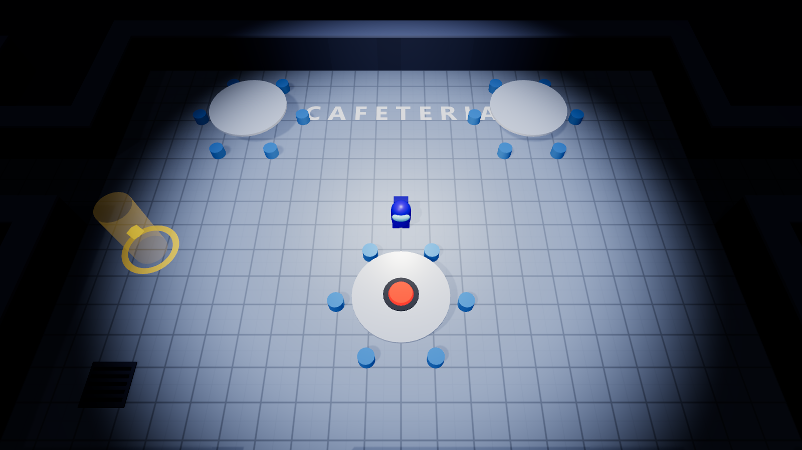
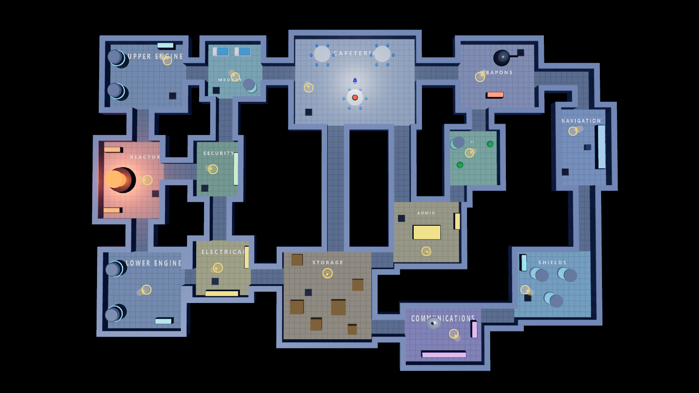

# PATIENT ZERO — Unity

เกม Social Deduction ผู้ติดเชื้อซ่อนตัวอยู่ในกลุ่มผู้รอดชีวิต (ต่อยอดจากแมป Skeld เดิม) · ไฟล์เกม `Builds/Windows/PatientZero.exe` · ดูหัวข้อ **PATIENT ZERO** ด้านล่างสำหรับกติกา/ระบบทั้งหมด

แปลงจากเว็บ three.js เดิม (`index.html`, `js/main.js`, `js/mapData.js` — ลบออกจากโฟลเดอร์แล้ว คอลัมน์ "มาจาก" ด้านล่างเก็บไว้เป็นที่มาเท่านั้น) เป็นโปรเจกต์ Unity 6 เต็มรูปแบบ
ฉากทั้งหมดสร้างด้วยโค้ดตอนเริ่มเกม (procedural) เหมือนเว็บเดิม — ไม่มี model / texture / เสียงนำเข้า

## วิธีเปิด

1. Unity Hub ▸ **Add project from disk** ▸ เลือกโฟลเดอร์ `UnityProject` (Unity **6000.0.85f2** หรือใหม่กว่าใน 6000.0)
2. เปิด `Assets/Scenes/Skeld.unity` แล้วกด **Play**
   - ถ้าไม่มี scene นี้: เมนู **Skeld ▸ Setup Project (Scene + Settings)**
   - จริง ๆ กด Play ใน scene ไหนก็ได้ เกมจะสร้างตัวเองผ่าน `[RuntimeInitializeOnLoadMethod]`

## เมนู · สร้างห้อง · การตั้งค่า (`MenuUI.cs`, `GameSettings.cs`)

ลำดับหน้า: **หน้าชื่อเกม** (Enter/คลิก) → **เมนูหลัก** → เริ่มเกมทันที / **สร้างห้อง** / เข้าร่วมห้อง / เลือกตัวละคร / วิธีเล่น / ตั้งค่า / ออก · ระหว่างเล่นกด **Esc** = เมนูพัก (โลกหยุด: ต่อเกม / ตั้งค่า / วิธีเล่น / เริ่มแมตช์ใหม่ / กลับเมนูหลัก / ออก) · จบเกมกด R = เริ่มแมตช์ใหม่ทันที (ข้ามเมนู)

- เมนูวาดบนผืนผ้าใบ 1600×900 แล้วปรับสเกลตามหน้าจอ (ดูเหมือนกันทุกความละเอียด) · ฉากหลังเป็นแผนที่หมุนวน
- **สร้างห้อง** (`RoomSettings`): ชื่อห้อง · รหัสห้อง · จำนวนผู้เล่น 5–10 · ผู้ติดเชื้อต้นตอ 1–3 · ความยาก (ง่าย/ปกติ/ยาก) · ความยาวกลางวัน/กลางคืน · ซอมบี้กลางคืน 0–8 · ภารกิจต่อคน 2–8 · บทบาทของคุณ (สุ่ม/ผู้รอดชีวิต/ผู้ติดเชื้อ) · เปิด/ปิดความสามารถอาชีพ · รายชื่อผู้เล่นในห้อง (บอทเติมที่ว่าง) — จำค่าล่าสุดไว้
- **เข้าร่วมห้อง**: มีหน้าและช่องกรอกรหัสแล้ว แต่ยังใช้ไม่ได้ (รอระบบออนไลน์) — โค้ดแยกตรรกะไว้ให้ต่อ Server ได้

**ตั้งค่า** (บันทึกลง PlayerPrefs ทุกครั้งที่เปลี่ยน · มีปุ่มคืนค่าเริ่มต้น):

| หมวด | รายการ |
|---|---|
| ภาพ | โหมดหน้าจอ (เต็มจอไร้ขอบ / เต็มจอพิเศษ / หน้าต่าง) · ความละเอียด · V-Sync · จำกัดเฟรมเรต (30–240) · คุณภาพภาพ ต่ำ–สูงมาก (เงา/MSAA/aniso) · **ขนาด UI (สเกล)** 70–160% |
| เสียง | เสียงรวม · เอฟเฟกต์ · เสียงบรรยากาศ (โดรนวนลูป + จังหวะหัวใจ) · ปิดเสียงทั้งหมด (N) · ทดสอบเสียง |
| การเล่น | ชื่อผู้เล่น · ความไวกล้อง · กล้องสั่น · ป้ายชื่อเหนือหัว · กล่องคำอธิบายปุ่ม · แสดง FPS |
| ปุ่มควบคุม | ตารางปุ่มทั้งหมด (ยังไม่รองรับการตั้งปุ่มเอง) |

- **F11** สลับเต็มจอ/หน้าต่างได้ทุกที่ · ค่าเริ่มต้น: เต็มจอไร้ขอบตามหน้าจอ, V-Sync เปิด, คุณภาพสูงมาก
- ค่าหน้าจอ/ความละเอียดมีผลเฉพาะตัวเกมที่ build แล้ว (ไม่เปลี่ยนหน้าต่าง Game ใน Unity Editor) · ขนาด UI ใช้กับ HUD/มินิเกมในเกม

## PATIENT ZERO — กติกาและระบบ (`PatientZero.cs`, `PZHud.cs`)

เวอร์ชันนี้เล่นคนเดียวกับบอท 7 ตัว (รวม 8 คน) · ยังไม่มีออนไลน์ — ตรรกะทั้งหมดอยู่ใน `PZ` แยกจาก UI/ฉาก เพื่อย้ายไปรันบน Server (Server เป็นผู้ตัดสินบทบาท/การติดเชื้อ) ภายหลัง

**บทบาท** (สุ่มทุกเกม · ผู้ติดเชื้อต้นตอ 2 คน): ผู้รอดชีวิต / ผู้ติดเชื้อต้นตอ · **อาชีพ** (ทุกคนเห็นใต้ชื่อ): ผู้รอดชีวิต 3 · หมอ 2 · นักวิทยาศาสตร์ 2 · ตำรวจ 1

| ระบบ | รายละเอียด |
|---|---|
| ภารกิจ / วัคซีน | แต่ละคนได้ภารกิจไม่ซ้ำกันคนละ 5 จาก 14 (ผู้เล่นเห็นเฉพาะของตัวเอง) · ความคืบหน้าวัคซีน = ภารกิจที่ผู้รอดชีวิตทั้งหมดทำเสร็จ · ผู้ติดเชื้อทำหลอก ไม่นับ · ภารกิจค้างของคนที่หลุดจากเกมถูกตัดออกจากยอด |
| กัด / ฟักเชื้อ | ผู้ติดเชื้อกัดด้วยปุ่ม **"กัด" บนจอ (คลิก)** หรือกด **B** (คูลดาวน์ 25 วิ · ปุ่มแสดงเป้าหมาย/เวลารอ · เป้าหมายที่กัดได้มีป้าย "▼ กัดได้" เหนือหัว · จอวาบแดงตอนกัด) · **แอนิเมชันกัด** (`BiteFx.cs`): ผู้กัดพุ่งโน้มตัวงับ → หยดเลือดกระเด็น + วงแหวนแดงที่พื้น + ฟอง "กัด!" → เหยื่อสะดุ้งกระเด็นถอย · ซอมบี้กัดก็มีท่าเดียวกัน · ผู้เล่นถูกกัดกล้องกระตุก → เหยื่อฟักเชื้อ **30–60 วินาที** แล้วกลายเป็นซอมบี้ (ทุกคนเห็น) · ซอมบี้ไล่กัดผู้รอดชีวิตต่อ · มีพยานเห็นการกัดได้ (ระยะ 7 กลางวัน / 3.8 กลางคืน) |
| อาการ | ผู้ที่กำลังฟักเชื้อไอ (เสียง + ฟองคำพูด) · ผู้เล่นเองจะจอแดง/กล้องสั่นยิ่งใกล้กลายเป็นซอมบี้ · ผู้รอดชีวิตปกติไอหลอกได้นาน ๆ ครั้ง |
| ประชุม / โหวต | เรียกด้วยปุ่มแดงบนโต๊ะโรงอาหาร (**F**, คนละ 1 ครั้ง) · บอทเรียกเองเมื่อเห็นการกัด/พบซอมบี้ · ทุกรุ่งเช้า · ผู้ที่ถูกโหวตมากสุดถูกกักกันและเปิดเผยบทบาท · เสมอ/ข้าม = ไม่มีใครถูกกัก |
| กลางวัน-กลางคืน | วัน 150 วิ → คืน 45 วิ (ไฟดับ หมอกแคบ ซอมบี้ NPC 3 ตัวบุก) → ประชุมรุ่งเช้า → วัน … |
| ความสามารถ | **หมอ**: ตรวจเลือด **T** 2 ครั้ง (ผลออก 20 วิ ติดเชื้อ/ปกติ) · **ตำรวจ**: มีปืนพกติดตัว (ปืนอยู่ในกำปั้นขวา: ใช้ท่า `holding-right` ของโมเดลซ้อนบนแขนขวาเท่านั้น ขายังเดินตามปกติ · ปืนตามกระดูก `arm-right` แต่ปากกระบอกหันตามทิศที่ตัวละครหันเสมอ — `ModelMascot` เลเยอร์ท่าถือ + `GunFollow`) เล็ง+ยิงด้วย **G** หรือปุ่ม "ยิง" บนจอ — 1 นัด · เป้าหมาย = คนที่อยู่ในมุม ±28° ระยะ 8 · ยิงผู้ติดเชื้อ/ซอมบี้ถูก = ถูกกำจัด · ยิงผู้บริสุทธิ์ = ตัวเองตาย · มีแฟลช/เส้นกระสุน/เสียงปืน/เลือดกระเด็น (`GunProp.cs`, `BiteFx.Shoot`) · บอทตำรวจยิงซอมบี้และคนที่เห็นกับตาว่ากัด · **นักวิทยาศาสตร์**: เห็นวัคซีนเป็น % ละเอียด |
| ชนะ | ผู้รอดชีวิต: วัคซีนครบ หรือกักกันต้นตอ+ซอมบี้หมด · ผู้ติดเชื้อ: ต้นตอ ≥ ผู้รอดชีวิตที่ยังเป็นคน หรือหมดเวลา 14 นาที |
| ถูกกักกัน/เป็นซอมบี้ | รับชมบอทต่อ (Space สลับคนที่ดู) · จบเกมกด **R** เริ่มใหม่ |

- ปรับสมดุลที่ค่าคงที่ต้นไฟล์ `PZ` (`DayLen`, `IncubMin/Max`, `BiteCooldown`, `BotWork*`, ความเร็วซอมบี้) และใน `BotAI/InfectedHunt` · ทดลองจำลองบอทล้วน 40 แมตช์ ผู้รอดชีวิตชนะ ≈ 75% (ผู้เล่นจริงเล่นช้ากว่าบอท ฝั่งผู้ติดเชื้อจึงได้เปรียบขึ้นเล็กน้อย)
- บอท: เดินด้วย A* บนกริด (`FindPath`) · ผู้รอดชีวิตทำภารกิจ/หนีซอมบี้/สะสมความสงสัย (พยาน, ไอ, ซอมบี้, "ใครอยู่ใกล้ก่อนป่วย") · ผู้ติดเชื้อทำภารกิจหลอกและตามกัดคนที่อยู่ลำพัง
- ตัวเลือกทดสอบ (บรรทัดคำสั่ง): `-pz-role infected|survivor` · `-pz-job doctor|scientist|police|survivor` · `-pz-daylen <วินาที>` ย่อวันแรก · `-pz-gameover survivors|infected` ดูหน้าสรุปผล
- ที่ยังไม่ทำ: ออนไลน์หลายผู้เล่น (Host เป็น Server), ห้องกักกันแบบมีฉาก, เทอร์โมมิเตอร์, สถานีตรวจเลือดแบบตั้งโต๊ะ

## ปุ่มควบคุม

| ปุ่ม | ทำอะไร |
|---|---|
| W A S D / ลูกศร | เดิน (สัมพันธ์กับทิศกล้อง) |
| Q E | หมุนกล้อง |
| ล้อเมาส์ | ซูม |
| M / Tab | แผนที่ทั้งหมด (Overview) |
| R | (จบเกม) เริ่มใหม่ · โหมด Patient Zero ปิดการวาร์ปกลับจุดเกิด |
| F / Space | เปิดมินิเกมเควสที่จุดเหลือง (เล่นด้วยเมาส์ · Esc = ปิด) · ที่ปุ่มแดงโรงอาหาร = เรียกประชุม |
| B / T / G | กัด (ผู้ติดเชื้อ) / ตรวจเลือด (หมอ) / ยิง (ตำรวจ) |
| V | เปิด/ปิดหมอก |
| N | เปิด/ปิดเสียง |

## โครงสร้าง

| ไฟล์ Unity | มาจาก | หน้าที่ |
|---|---|---|
| `Scripts/MapData.cs` | `js/mapData.js` | ห้อง ทางเดิน เควส ช่องระบาย ของตกแต่ง + กริดชนกำแพง |
| `Scripts/MapBuilder.cs` | ส่วนสร้างฉากใน `main.js` | ดวงดาว พื้น ป้ายชื่อห้อง กำแพง (รวมเป็นเมชเดียว) |
| `Scripts/PropFactory.cs` | `propBuilders` | engine, reactor, table, crate, console, bed, tank, plant, dish, turret, vent |
| `Scripts/MeshBuilder.cs` | `THREE.*Geometry` | สร้าง Box/Cylinder/Sphere/Capsule/Octahedron/Icosahedron/Ring ด้วยโค้ด |
| `Scripts/Crewmate.cs` | `createCrewmate` | ตัวละคร + ขาแกว่ง |
| `Scripts/SkeldGame.cs` | logic ใน `main.js` | input, ชน, กล้อง, เควส, หมอก, แสง |
| `Scripts/Hud.cs` | HUD ใน `index.html` + minimap | location / tasks / minimap / prompt / banner / help (IMGUI) |
| `Scripts/ProceduralAudio.cs` | `playStep` / `playChime` | สังเคราะห์เสียงเดินและเสียงติ๊งด้วยโค้ด |
| `Scripts/GameInput.cs` | — | รองรับทั้ง Input Manager เดิมและ Input System package |
| `Scripts/ToneMapper.cs` + `Resources/Skeld/SkeldTonemap.shader` | `ACESFilmicToneMapping` | tone mapping ตัวเดียวกับ three.js (exposure 1.15) |
| `Resources/Skeld/*.shader` | `MeshStandardMaterial` + `patchFog` | shader มีหมอกจาก "ตัวละคร" (ไม่ใช่จากกล้อง) |

## แมปจาก Kenney Modular Space Kit

พื้นและกำแพงสร้างจากชิ้นส่วน [Modular Space Kit](https://kenney.nl/assets/modular-space-kit) (CC0) ที่ `Assets/Resources/SpaceKit/` ผ่าน `KitMapBuilder.cs`
เกมเพลย์ไม่เปลี่ยน (กริด การชน เควส minimap ยังเป็นข้อมูลเดิมใน `MapData.cs`) เปลี่ยนเฉพาะหน้าตา

- **พื้น**: `template-floor` ย่อ 4 หน่วย → 1 ช่องกริด ปูทุกช่อง สุ่มลายช่องระบาย (`template-floor-detail-a`) ~7% และ tint สีห้องเบา ๆ
- **กำแพง**: `template-wall` วางทุกขอบที่พื้นติดช่องว่าง หันด้านตกแต่งเข้าห้อง วางชิดนอกขอบจึงไม่กินพื้นที่เดิน · ความสูงปรับที่ `KitMapBuilder.WallYScale` (ตอนนี้ 0.32 → สูง ~1.36)
- **เสาปิดมุม**: `template-detail` วางทุกมุมนูน/มุมเว้า
- **พาเลตต์สี**: ทางเดินและห้องส่วนใหญ่ = ส้ม · MEDBAY/SECURITY/NAVIGATION/SHIELDS/COMMS = ฟ้า (variation-a) · O2/ELECTRICAL = เขียว (variation-b) — แก้ที่ `KitMapBuilder.VariantOf`
- **ประสิทธิภาพ**: รวมเมชเป็น 6 ก้อนตอนเริ่มเกม (~440k สามเหลี่ยม, ใช้เวลาสร้าง ~0.2 วินาที) เมชของ FBX ต้องเปิด Read/Write ซึ่ง `Editor/KenneyImportPostprocessor.cs` ตั้งให้อัตโนมัติ (ถ้าเปิดโปรเจกต์ใหม่แล้วชิ้นส่วนไม่ขึ้น ใช้เมนู **Skeld ▸ Reimport Kenney Assets**)
- **สลับกลับแมปเดิม**: เลือก object **SkeldGame** → ติ๊ก **Use Kenney Kit** ออก (หรือถ้าชิ้นส่วนไม่ครบ ระบบจะใช้แมปเดิมให้เอง)
- ยังไม่ได้ใช้: ประตู/gate, ทางเดินสำเร็จรูป, ห้องสำเร็จรูป (`room-*`), บันได — ขนาดห้องในเกมไม่ตรงกับโมดูล 12/20 หน่วยของชุดนี้

## อุปกรณ์โรงพยาบาลใน MEDBAY

| ชิ้น | วิธีสร้าง | ไฟล์ |
|---|---|---|
| เตียงโรงพยาบาล ×2 (พนักหัวยก ราวข้าง ผ้าห่ม ล้อ) | โค้ด | `MedicalProps.Bed` |
| เสาน้ำเกลือ (ฐาน 5 แฉก ถุงเรืองแสง สายยาง) | โค้ด | `MedicalProps.IvStand` |
| จอมอนิเตอร์สัญญาณชีพ (กราฟ ECG วาดเป็นเท็กซ์เจอร์ด้วยโค้ด) | โค้ด | `MedicalProps.Monitor` |
| ตู้ยา (บานกระจก กากบาทแดง) | โค้ด | `MedicalProps.Cabinet` |
| รถเข็นยา (ลิ้นชัก 3 ชั้น ล้อ ของบนถาด) + เครื่องกระตุกหัวใจ | โค้ด + FBX | `MedicalProps.Cart` |
| เครื่องสแกนวินิจฉัย (ซุ้มสแกน แท่น แสงสแกน) | โค้ด | `MedicalProps.Scanner` |
| รถเข็นผู้ป่วย, เครื่องกระตุกหัวใจ, ไม้ค้ำยัน | FBX ของ Kenney (`Resources/MedicalAids/`) | `ModelProp.cs` |

- วางตำแหน่งที่ `MapData.Props` (ส่วน MedBay) · ชิ้นที่มีรอยเท้า (w/d หรือ r) เข้าระบบชนอัตโนมัติ
- พารามิเตอร์ `rot:` หมุนพร็อพรอบแกน Y: 0 = หันเข้าหากล้องเริ่มต้น, 90 = หันไป −x, 270 = หันไป +x, 180 = หันขึ้นบนจอ (w/d ใส่เป็นขนาดรอยเท้า "ในโลก" ระบบสลับให้เองตอนหมุน 90/270)
- วางเลี่ยงประตู 3 บานของห้องและจุดเควส Submit Scan ไว้แล้ว (ทดสอบว่าเดินถึงเควสและประตูครบทุกบาน)
- เพิ่มอุปกรณ์ใหม่: เขียนฟังก์ชันใน `MedicalProps.cs` → เพิ่ม `case` ใน `PropFactory.Build` → เพิ่ม `P("ชื่อ", x, z, ...)` ใน `MapData.Props`

## อุปกรณ์ห้อง REACTOR

| ชิ้น | วิธีสร้าง | ไฟล์ |
|---|---|---|
| แผงสตาร์ทเครื่อง (กราฟแท่งสถานะ + จอคลื่นพลังงาน ปุ่มสตาร์ท คันโยก ไฟสถานะ) | โค้ด + เท็กซ์เจอร์ที่วาดด้วยโค้ด | `ReactorProps.Panel` |
| ถังแรงดันสารหล่อเย็น (วาล์ว เกจ) | โค้ด | `ReactorProps.PressureTank` |
| เครื่องกำเนิดไฟฟ้า/เทอร์ไบน์ (ครีบระบายความร้อน ปล่องไอเสีย) | โค้ด | `ReactorProps.Generator` |
| ถังสารกัมมันตรังสี ×3 | โค้ด | `ReactorProps.Barrel` |
| วงแหวนเตือนอันตรายบนพื้นรอบแกน, ท่อหล่อเย็นแนวผนัง, ไฟเตือนบนคอนโซล | โค้ด | `HazardRing` / `Pipe` / `Beacon` |
| สายเคเบิลบนพื้น | โมเดล `cables` จาก Space Kit | `ModelProp` |
| ตัวแกนเครื่องปฏิกรณ์: แท่งเชื้อเพลิงเรืองแสง 8 แท่ง แถบรัด ท่อต่อออกจากฐาน | โค้ด (ต่อยอดของเดิม) | `PropFactory.Reactor` |

- ชิ้นตกแต่งที่ไม่มีรอยเท้า (`hazardring`, `pipe`, `cables`, `beacon`) ไม่เข้าระบบชน · `h:` ของ `hazardring` = รัศมีนอก, ของ `pipe` = ความยาว
- วางเลี่ยงประตู 3 บานและจุดเควส Start Reactor ไว้แล้ว (ทดสอบเดินถึงเควสและประตูครบ)

## อุปกรณ์ประจำห้อง (ห้องที่เหลือทั้งหมด)

สร้างด้วยโค้ดใน `FacilityProps.cs` โทนเดียวกับ MEDBAY/REACTOR · เท็กซ์เจอร์หน้าจอ (CCTV, เรดาร์, แผนที่ดาว, ตู้เซิร์ฟเวอร์, แดชบอร์ด, แผงสายไฟ, ตู้กดอาหาร) วาดด้วยโค้ดใน `TexLib.cs`

| ห้อง | อุปกรณ์ที่เพิ่ม |
|---|---|
| UPPER / LOWER ENGINE | วงแหวนเตือนรอบเครื่องยนต์, ท่อผนัง, โต๊ะช่าง, ถังเชื้อเพลิง · (Lower) เครื่องกำเนิดไฟ |
| CAFETERIA | ตู้กดอาหาร ×2, เคาน์เตอร์เสิร์ฟอาหาร, ตู้น้ำดื่ม, ถังขยะ, ต้นไม้ |
| WEAPONS | ชั้นวางขีปนาวุธ ×2, สถานีเรดาร์, ลังกระสุน |
| SECURITY | ผนังจอ CCTV 3×2, เก้าอี้, ล็อกเกอร์, เครื่องรูดการ์ด |
| O2 | เครื่องกรองอากาศ, แปลงไฮโดรโปนิกส์ (ไฟปลูกชมพู), ท่อผนัง |
| NAVIGATION | โต๊ะโฮโลแกรมลูกโลก, เก้าอี้นักบิน, จอแผนที่ดาว |
| ADMIN | ตู้เอกสาร, เครื่องพิมพ์, ตู้เซิร์ฟเวอร์ ×2, จอแดชบอร์ด |
| ELECTRICAL | แผงเบรกเกอร์, แผงสายไฟ 4 สี, หม้อแปลง, ม้วนสายไฟ |
| STORAGE | ชั้นวางของ ×3, เครื่องเติมเชื้อเพลิง, ถังบรรจุ, รถเข็นสินค้า |
| COMMUNICATIONS | ตู้เซิร์ฟเวอร์ ×3, เสาอากาศ, โต๊ะวิทยุ, จอสัญญาณ |
| SHIELDS | เสากำเนิดโล่ ×2, ชุดตัวเก็บประจุ ×2, แท่นโฮโลแกรม |

- ตำแหน่งอยู่ที่ `MapData.Props` (ช่วง "อุปกรณ์ประจำห้อง ชุดที่ 3") · ทุกชิ้นวางเลี่ยงประตูและจุดเควส ทดสอบแล้วว่าเดินถึงเควสครบ 14 จุดและไม่มีจุดเควสถูกบัง
- ชิ้นที่ติดผนัง (จอ, แผงเบรกเกอร์ ฯลฯ) หันด้านหน้าเข้าห้อง: ใช้ `rot` ตามผนัง (ผนังเหนือ 0 · ใต้ 180 · ตะวันออก 90 · ตะวันตก 270)
- ใช้ซ้ำของเดิม: `pipe`, `hazardring`, `generator`, `barrel`, `plant`, `crate`

## สภาพแวดล้อมนอกแมป (ตามภาพ Blueprint ฐานทัพ)

แทนพื้นหลังอวกาศดำ/ดวงดาวเดิม ด้วย `SurroundBuilder.cs` (ทุกอย่างอยู่นอกกริดเดิน ไม่มีการชน เกมเพลย์ไม่เปลี่ยน):

| ส่วน | รายละเอียด |
|---|---|
| พื้น | หญ้ามืดผืนใหญ่รอบนอก + พื้นกรวดเทาเข้มภายในรั้ว (วางใต้แมปทั้งหมด จึงอุดช่องดำใต้ฐานกำแพงด้วย) · เท็กซ์เจอร์วาดด้วยโค้ด tile ได้ |
| รั้ว | ลวดตาข่ายโปร่งแสง เสา + ราว 2 เส้น รอบคอมพาวด์ |
| ป่า | ต้นไม้ low-poly ~770 ต้นนอกรั้ว รวมเมชเป็น 2 ก้อน |
| ในรั้ว | หิน พุ่มไม้ เสาไฟคู่พร้อมแสงเรืองบนพื้น (~30 ต้น) |
| ลานเฮลิคอปเตอร์ | มุมซ้ายบน: ขอบเหลือง-ดำ ตัว H ไฟแดง 4 มุม |
| เต็นท์พยาบาล | มุมขวาล่าง: หลังคากากบาทแดง ถัง/ลังหน้าเต็นท์ |

- เปิด/ปิด: object **SkeldGame** → ติ๊ก **Use Surroundings** (ปิด = อวกาศดำ + ดวงดาวแบบเดิม)
- ปรับตำแหน่งรั้ว ลานจอด เต็นท์ ที่ค่าคงที่ต้นไฟล์ (`FX0..FZ1`, `PadCenter`, `TentCenter`) · ความหนาแน่นป่าที่ `step` ใน `AddForest`
- สีพื้นหลังกล้องไกลสุดตั้งเป็นเขียวเกือบดำ (`SkeldGame`) เพื่อไม่ให้เห็นขอบพื้นหญ้าเป็นสีน้ำเงินอวกาศ

## WEAPONS แบบ Armory (คลังอาวุธ)

ตกแต่งตามภาพอ้างอิง Armory ด้วย `ArmoryProps.cs` (คงป้อมปืน คอนโซลเดิม และจุดเควส Clear Asteroids ไว้):
แผงแขวนปืนไรเฟิล 2 แถว + ไฟส้ม (`gunrack`) · หีบกระสุน (`ammochest`) · ตู้เก็บกระสุนทรงสูง (`ammolocker`) · แท่นกระสุนทรงกระบอก (`ammotower`) ·
ตู้เก็บอาวุธใหญ่ (`weaponlocker`) · ลังอาวุธซ้อน (`weaponcrate`) · แผงควบคุมประตูสีฟ้า (`accesspanel`) · แถบไฟสีฟ้า (`lightstrip`) · ขีดประเหลืองบนพื้น (`hazardzone`)

- ของตกแต่งที่ไม่มีการชน (เช่น `hazardzone`) ต้องใส่ขนาดด้วย `sx:` / `sz:` **ห้ามใช้ `w:` / `d:`** เพราะระบบชนจะนับเป็นสิ่งกีดขวาง

## ของชิ้นเล็กที่เดินชน/ผลักได้ (`PushWorld.cs`)

- ถัง (`barrel`) · เสาน้ำเกลือ · ถังขยะ · ตู้กดน้ำ · กระถางต้นไม้ · รถเข็นผู้ป่วย/รถเข็นยา/รถขนของ · ม้วนสายเคเบิล · ลังเล็ก (`crate`/`weaponcrate` ขนาด ≤ 1.6) **ผลักได้เมื่อเดินชน** และชนเป็นวงกลมจริง ไม่ใช่ช่องกริด 1×1 แล้ว
- ความหนักต่างกันตามชนิด (`Weight()` ใน PushWorld) — ยิ่งหนักตัวละครยิ่งถูกหน่วง · ผลักต่อกันเป็นทอดได้ · ไม่ทะลุกำแพง
- กันเกมค้าง: ผลักได้ไกลสุด `Leash` (2.4) จากจุดเดิม · ไม่ออกนอกห้อง · ไม่เข้าใกล้จุดเควส/จุดเกิด (`KeepOut`) · ชิ้นที่เกิดใกล้จุดเควส (< 1.3) จะเป็นของตันเหมือนเดิม · กด **R** คืนที่
- ชิ้นที่ผลักได้ **ไม่ถูกนับเป็นช่องตัน** ใน `MapGrid` (ข้ามใน `MarkProp`) · ปิดทั้งระบบ: `PushWorld.Enabled = false` (ของชิ้นเล็กกลับเป็นช่องตันธรรมดา)
- วางของใหม่ให้ผลักได้: เพิ่มชนิดใน `Weight()` แล้ววาง `P(...)` ให้อยู่ **ในห้องทั้งวง** (ขอบ + รัศมีต้องไม่เกินผนัง ไม่งั้นจะเป็นของตัน)

## มินิเกมประจำภารกิจ (`TaskGames.cs`)

ยืนใกล้จุดเหลืองแล้วกด **F / Space** → เปิดมินิเกมกลางจอ (ตัวละครหยุดเดิน) · ต้อง **เล่นจนสำเร็จ** จึงนับภารกิจเสร็จ · **Esc** หรือปุ่ม X = ปิดโดยไม่นับ · เล่นด้วยเมาส์ล้วน

| ภารกิจ | มินิเกม |
|---|---|
| Align Engine Output (บน/ล่าง) | ลากแถบเลื่อนให้ลำพลังงานตรงเส้นกลาง แล้วปล่อย · 2 รอบ |
| Submit Scan | กดเมาส์ค้างที่ปุ่มจนสแกนครบ (ปล่อย = ถอยกลับ) |
| Download / Upload Data | กดเริ่ม → ไฟล์ไหล → สัญญาณหลุดกลางทาง ต้องกด "เชื่อมต่อใหม่" |
| Clear Asteroids | คลิกยิงอุกกาบาตที่ลอยผ่านให้ครบ 15 ก้อน |
| Start Reactor | จำลำดับไฟบนปุ่ม 3×3 แล้วกดตาม · 5 รอบ ยาวขึ้นเรื่อย ๆ |
| Swipe Card | ลากบัตรผ่านเครื่องอ่าน · เร็ว/ช้าเกินไปอ่านไม่ติด |
| Clean O2 Filter | ลากใบไม้ 8 ใบออกนอกตัวกรอง |
| Chart Course | ลากยานตามเส้นทางไปดาวปลายทาง ห้ามออกนอกเส้น |
| Fix Wiring | ลากสายต่อสีเดียวกัน ซ้าย → ขวา (ฝั่งขวาสลับลำดับ) |
| Fuel Engines | กดค้างเติมน้ำมันให้ระดับอยู่ในแถบเขียวแล้วปล่อย (ล้น = หก) · 2 ถัง |
| Prime Shields | ปริศนาไฟ 7 ช่อง: คลิกช่องจะสลับช่องนั้น + ช่องข้างเคียง (สร้างจากการสุ่มย้อนกลับ ⇒ แก้ได้เสมอ) |

- เพิ่มมินิเกมใหม่: สืบทอด `MiniGame` (Title/Help/Tick/Draw, เรียก `Finish()` เมื่อสำเร็จ) แล้วเพิ่ม `case` ใน `TaskGames.Begin()` ตาม id ของภารกิจใน `MapData.Tasks`
- พิกัดในเกมเป็นพิกัดท้องถิ่น 0..700 × 0..380 · เมาส์ใช้ `C.Pos / C.Down / C.Up / C.Held` (อ่านจากอีเวนต์ IMGUI จึงใช้ได้ทั้ง Input เดิมและ Input System)
- เสียงคลิก/ผิดพลาดใช้ `ProceduralAudio.MakeBlip()` (pitch สูง = ถูก · ต่ำ = ผิด)

### จุดภารกิจ ↔ อุปกรณ์ (จุดเหลืองอยู่หน้าเครื่องจริง)

| ภารกิจ | อุปกรณ์ที่ยืนหน้า | หมายเหตุ |
|---|---|---|
| Submit Scan | แท่นสแกน (`scanner`) | **ยืนบนแท่นในซุ้ม** ตัวละคร/วงแหวนยกขึ้นเท่าเตียง (`TaskDef.y`, `StandHeightAt`) · ตันเฉพาะเสา 2 ข้าง (`MapGrid.MarkProp`) |
| Align Engine Output (บน/ล่าง) | แท่นปรับเครื่องยนต์ `aligner` (ใหม่) | แถบเลื่อน 2 เส้น + เส้นเป้าหมายเขียว ข้างเครื่องยนต์ |
| Download Data (โรงอาหาร) | ตู้ข้อมูล `datakiosk` (ใหม่) | จอลูกศรลง + ช่องแท็บเล็ต |
| Upload Data (Admin) | ตู้ข้อมูล `datakiosk` (`button: true`) | ลูกศรขึ้น |
| Download Data (Comms) | คอนโซลสื่อสาร (หันจอเข้าห้อง `rot: 180`) | |
| Clear Asteroids | ป้อมปืน `turret` | |
| Start Reactor | แผงเตาปฏิกรณ์ `reactorpanel` | |
| Swipe Card | เครื่องรูดบัตร `cardreader` | |
| Clean O2 Filter | ตัวกรองอากาศ `airfilter` | |
| Chart Course | จอแผนที่ดาว `starboard` | |
| Fix Wiring | แผงสายไฟ `wirepanel` (ใหม่) | สาย 4 สีไขว้ ตรงกับมินิเกม |
| Fuel Engines | ปั๊มน้ำมัน `fuelpump` | |
| Prime Shields | แท่นควบคุมโล่ `shieldpanel` (ใหม่) | ไฟกลม 7 ดวงเรียงรังผึ้ง |

- โมเดลใหม่ทั้ง 4 อยู่ที่ [TaskProps.cs](Assets/Scripts/TaskProps.cs) · ย้ายจุดเควส = แก้พิกัดใน `MapData.Tasks` (ให้ยืนห่างของตัน ≥ 0.6 และไม่บังทางเดิน) · ยืนบนอะไรสูง ๆ ใส่พารามิเตอร์ `y` ตัวที่ 6 ของ `TaskDef`

## กันภาพกระพริบ (บทเรียน)

- **z-fighting:** อย่าวางกล่องสองใบที่หน้าบนอยู่ระนาบเดียวกัน (เช่น ขอบแปลง `rim` กับผิวดิน `soil` เดิมสูงเท่ากัน → ดินโผล่/หายสลับเฟรม) ให้เหลื่อมความสูงอย่างน้อย ~0.01
- **เท็กซ์เจอร์ชุด Space Kit:** ต้องเปิด mipmap + Trilinear + Anisotropic (ตั้งใน `KenneyImportPostprocessor.cs`) ไม่งั้นเส้นกระเบื้องพื้นกะพริบ
- **แผง prompt เควส:** ใช้ hysteresis (รัศมีขาออก +0.5) และเฟดเข้า/ออก (`PromptAlpha`) กันโผล่เฟรมเดียวตอนวิ่งผ่านขอบรัศมี

## หน้าเลือกตัวละคร

เปิดอัตโนมัติตอนเริ่มเกม และกด **C** เปิดซ้ำได้ทุกเมื่อ · มีให้เลือก **29 ตัว**: โมเดล Kenney 20 ตัว (Alien, Robot, Knight, Zombie, Soldier, Raider, Worker, Male A–G, Female A–F) + Crewmate เดิม 9 สี

| ปุ่ม | ทำอะไร |
|---|---|
| **C** | เปิด/ปิดหน้าเลือกตัวละคร |
| คลิกการ์ด / ลูกศร | เลือกตัวละคร (เปลี่ยนในเกมทันที) |
| Enter / Space / Esc / ปุ่ม "เริ่มเล่น" | ปิดหน้าเลือกแล้วเล่นต่อ |
| **[** และ **]** | สลับตัวละครก่อนหน้า/ถัดไปได้ทันทีระหว่างเดิน (ไม่ต้องเปิดเมนู) |

- รูปย่อและตัวอย่างใหญ่เป็นโมเดล 3D จริง เรนเดอร์ใน "ฉากถ่ายตัวอย่าง" ที่ซ่อนไว้ไกลจากแมป (layer 31 + ไฟของตัวเอง) กล้องหลักไม่เห็น (`CharacterSelect.cs`)
- ตัวใหม่ยืนที่เดิม หันทิศเดิม · ตัวที่เลือกถูกจำไว้ (PlayerPrefs `Skeld.Character`) ครั้งหน้าเริ่มด้วยตัวนั้น
- เพิ่มตัวใหม่: วาง `.fbx` ใน `Assets/Resources/Characters/` แล้วเพิ่มบรรทัดใน `CharacterCatalog.Build()`
- ไม่ต้องการหน้านี้ตอนเริ่ม: เลือก object **SkeldGame** → ติ๊ก **Show Character Select On Start** ออก (ยังกด C ได้)

## เปลี่ยนตัวละคร (mascot) — ค่าเริ่มต้นใน Inspector

ตัวละครใช้โมเดล [Kenney Mini Characters](https://kenney.nl/assets/mini-characters) (CC0 — ใช้ได้ทั้งส่วนตัวและเชิงพาณิชย์ ไม่ต้องให้เครดิตแต่แนะนำ) ไฟล์อยู่ที่ `Assets/Resources/Characters/`

- ตัวเริ่มต้น (ใช้เมื่อผู้เล่นยังไม่เคยเลือกในหน้าเลือกตัวละคร): เปิด scene → เลือก object **SkeldGame** → ช่อง **Mascot Model** ใน Inspector
  - ชื่อที่ใช้ได้: `character-alien` (ค่าเริ่มต้น), `character-robot`, `character-knight`, `character-zombie`, `character-soldier`, `character-raider`, `character-worker`, `character-male-a` … `g`, `character-female-a` … `f`
  - `random` = สุ่มทุกครั้งที่เริ่มเกม · `crewmate` = ใช้ตัวประกอบจากโค้ดแบบเดิม (`Crewmate.cs`)
- แอนิเมชัน: ใช้คลิป `idle` ตอนยืน และ `sprint` ตอนเดิน ผสมแบบนุ่ม ๆ (`ModelMascot.cs`) ไม่ต้องมี Animator Controller
- ใช้โมเดลอื่น: วาง `.fbx` ไว้ใน `Assets/Resources/Characters/` (หันหน้า +Z, จุดอ้างอิงที่ฝ่าเท้า, มีคลิปชื่อ `idle` และ `sprint`) แล้วใส่ชื่อไฟล์ในช่อง Mascot Model · ปรับขนาดที่ `ModelMascot.Scale`
- หลังแก้ต้อง Build ใหม่: เมนู **Skeld ▸ Build Windows (x64)**

## จุดที่ต่างจากเว็บ (ตั้งใจ)

- **พิกัด**: ข้อมูลแมปยังเป็นพิกัดกริดเหมือนเว็บ แล้วแปลงเป็น Unity ด้วย `z → -z` (`MapData.ToWorld`) เพราะ Unity เป็นมือซ้าย ภาพจึงไม่กลับซ้าย-ขวา
- **แสง**: three.js ใช้หน่วยฟิสิกส์ (Lambert หาร π) แปลงเป็นค่า Unity = ค่าเดิม ÷ π (Directional 1.7→0.54, Hemisphere 1.25→0.40) ส่วน PointLight ของผู้เล่น/เครื่องปฏิกรณ์จูนให้ความสว่างใกล้เคียงเพราะสูตร attenuation ต่างกัน
- **Render pipeline**: ใช้ **Built-in RP + Forward** (shader เขียนด้วย Surface Shader) ถ้าจะย้ายไป URP/HDRP ต้องเขียน shader หมอกใหม่
- **Color space**: ตั้งเป็น Linear (เมนู Setup ทำให้) เพราะ three.js คำนวณแสงแบบ linear
- **HUD**: ใช้ IMGUI (ไม่ต้องติดตั้ง package เพิ่ม) · ภาษาไทยอาศัยฟอนต์ระบบ (Leelawadee UI / Tahoma) บน Windows
- **ดวงดาว**: ขนาดจุดคงที่ตามแพลตฟอร์ม (บน DX11 = 1px)
- **เงา**: เงาของดวงอาทิตย์จำกัดระยะ 70 หน่วย (`QualitySettings.shadowDistance`) จึงไม่มีเงาในโหมด Overview ที่ซูมออกไกล
